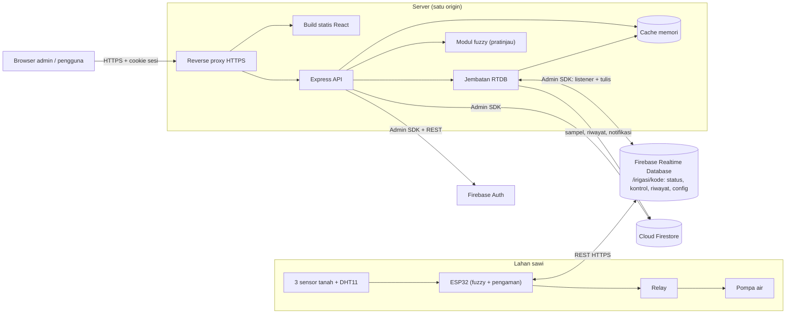
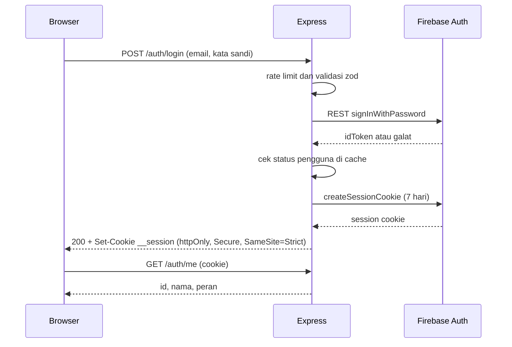
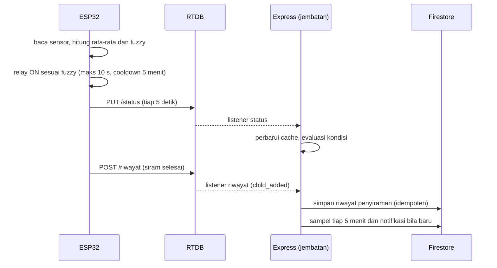
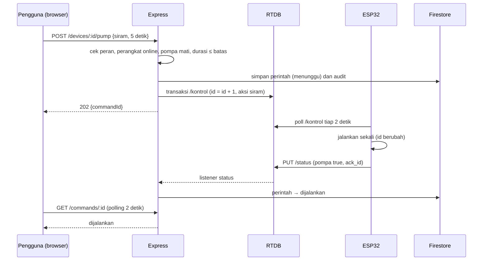

# Architecture — GREENFLOW Panel & Dashboard

> **Versi:** 0.2 (disesuaikan dengan PRD v0.3 dan kode IoT v4) · **Tanggal:** 3 November 2026
> **Bergantung pada:** `PRD.md` v0.3 (D1–D14, Q1–Q3, Q5–Q7, Q9, Q18–Q20 sudah dikunci)
> **Riwayat:** v0.1 (ESP32 → Express dengan token perangkat, fuzzy di server) → **v0.2 (ESP32 ↔ Realtime Database, Express sebagai jembatan, fuzzy di ESP32)**
> **Dokumen berikutnya:** `schema.md` v0.2 → `rules.md` → `design.md`
> **Cakupan:** frontend, backend, Firebase, dan kontrak data dengan ESP32. Firmware dan hardware di luar cakupan, kecuali perubahan yang diminta (PRD 8.4).

---

## 1. Prinsip Arsitektur

1. **Browser hanya berbicara dengan Express.** Express adalah satu-satunya pintu dari pengguna ke Firebase; aturan Firestore dan Realtime Database menolak semua akses klien (PRD D3, Q2).
2. **Hak akses ditegakkan di server**, bukan hanya di menu (SRS 3.1, E-03).
3. **ESP32 mandiri.** Keputusan penyiraman (fuzzy) dan semua pengaman pompa dijalankan di ESP32 (D11). Server tidak boleh menjadi syarat agar pompa bekerja.
4. **Realtime Database = kotak surat perangkat; Firestore = sumber kebenaran aplikasi.** Arah data satu jalur: perangkat → RTDB → Express → Firestore. Perintah dan konfigurasi: Firestore → Express → RTDB → perangkat (D13).
5. **Hemat kuota sejak awal**: dashboard dilayani dari cache memori yang diisi *listener* RTDB; Firestore hanya menerima sampel berkala dan kejadian.
6. **Sederhana dulu**: satu instance server, polling, satu repositori. Jalur naik kelas ada di bagian 17.
7. **Dapat dikembangkan tanpa perangkat keras**: Firebase Emulator Suite + simulator ESP32 (A5).

---

## 2. Keputusan Arsitektur (ADR ringkas)

| ID | Keputusan | Alasan | Konsekuensi |
|---|---|---|---|
| AD-01 | **Login dimediasi Express**: Express memverifikasi kata sandi lewat REST Firebase Auth lalu menerbitkan **session cookie** (`httpOnly`, `Secure`, `SameSite=Strict`) | Sesuai prinsip 1; token tak terjangkau JavaScript; frontend tanpa SDK Firebase | Express melihat kata sandi saat login/register (tidak disimpan); wajib proteksi CSRF (8.4) |
| AD-02 | **Satu origin**: frontend statis dan API dari domain yang sama (`/api/v1/*` di-proxy ke Express); saat dev, Vite *proxy* | Cookie `SameSite=Strict` tanpa CORS; permukaan serangan kecil | CORS dimatikan |
| AD-03 | Nama cookie `__session` | Satu-satunya cookie yang diteruskan Firebase Hosting ke Cloud Run | Menjaga opsi hosting terbuka |
| AD-04 | **Otorisasi memakai cache pengguna di memori** (*snapshot listener* koleksi `users`); custom claim `role` dipertahankan sebagai cermin | Perubahan peran/penonaktifan berlaku ≤ ~1 detik tanpa baca per request | Cache di-*warm* saat start |
| AD-05 | **Dashboard memakai polling 10 detik** dengan `ETag`/304, dilayani dari **cache status perangkat** (diisi listener RTDB) | Q3; polling tanpa biaya baca database | Jeda tampilan ≤ ~15 detik; SSE jadi peningkatan |
| AD-06 | **Satu instance Express** untuk v1 | Listener RTDB, penjadwal, dan anti-duplikat notifikasi lebih sederhana | Tidak *scale-out*; jalur naik kelas di 17 |
| AD-07 | **Monorepo npm workspaces**: `frontend`, `backend`, `packages/shared`, `simulator` | Skema zod dan fixture dipakai bersama | Satu `package-lock.json` |
| AD-08 | TypeScript di seluruh kode | Konsisten; tipe dibagi lewat `packages/shared` | TypeScript 7 hanya bila toolchain lolos |
| AD-09 | **TanStack Query** di frontend | Polling, cache, status loading/error seragam | Satu dependensi tambahan |
| AD-10 | **Identitas perangkat = jalur RTDB `/irigasi/{kode}`** terdaftar di `devices.rtdbPath`. Express hanya mendengarkan jalur milik perangkat yang terdaftar dan aktif. Tidak ada token perangkat ke Express | D13; firmware sudah memakai RTDB | Kredensial perangkat (saat ini *database secret*) berada di luar aplikasi; perbaikan lewat F4/F5 dan 13 |
| AD-11 | **Penyalinan idempoten**: sampel memakai ID per *slot waktu* (`{kode}_{epochDetik slot}`); riwayat memakai ID `{kode}_{kunciPushRTDB}` | Restart server/ulang proses tidak menggandakan data | Penulisan memakai `set` pada ID deterministik |
| AD-12 | **Firebase Emulator Suite** (Auth + Firestore + **Database**) untuk dev/test; produksi memakai proyek asli | Tanpa biaya/kuota saat simulasi | Perlu `firebase-tools` dan Java |
| AD-13 | **Satu perangkat = satu ESP32** dengan 3 sensor tanah (S1–S3), DHT11, dan 1 pompa. Sensor/pompa **bukan** entitas terpisah | PRD A2, Q20; menyederhanakan skema | Detail di `schema.md` |
| AD-14 | **Waktu baku = `ts`** (cap waktu server Firebase, UTC); jam RTC lokal hanya informasi; tampilan WITA | PRD A3, 8.3 | String `waktu` tidak dipakai untuk urutan |
| AD-15 | **Jembatan RTDB di Express** (`modules/bridge`): *listener* `/status` dan `/riwayat`, penulis `/kontrol` dan `/config` | D13 | Express wajib menangani koneksi putus/pulih |
| AD-16 | **Fuzzy di ESP32; modul fuzzy server identik hanya untuk pratinjau, simulator, dan verifikasi** dengan **fixture bersama** (`packages/shared/fixtures/fuzzy-cases.json` = PRD 7.5) | D11 | Perubahan fuzzy di firmware ⇒ perbarui modul + fixture |
| AD-17 | **Konfigurasi bersumber di Firestore** (`devices.config`), disalin ke RTDB `/config` dengan nomor `version` naik tiap simpan; ESP32 mengakui lewat `cfg_ver` di `/status` (F1, F2) | Halaman Parameter/Fuzzy/Kalibrasi harus berpengaruh nyata dan terbukti “sudah diterapkan” | Sebelum F1/F2 selesai, UI menampilkan “belum diterapkan perangkat” |
| AD-18 | **Perintah kontrol lewat transaksi RTDB** pada `/kontrol` (`id = id + 1`), dilacak di Firestore `commands` | Aksi dijalankan **sekali** per `id`; tidak ada perintah ganda | ESP32 mengabaikan `id` pertama saat boot |
| AD-19 | **Parameter melekat pada perangkat** (`devices.config`), bukan pada lahan | Firmware menerapkan parameter per perangkat | Lahan hanya berisi data master |

---

## 3. Gambaran Sistem



---

## 4. Komponen dan Tanggung Jawab

| Komponen | Teknologi | Tanggung jawab |
|---|---|---|
| **Frontend** | React 19, Vite, Tailwind v4, React Router 8, TanStack Query, react-hook-form + zod, ApexCharts (dasar TailAdmin) | Antarmuka, validasi formulir, polling, unduhan ekspor |
| **Backend API** | Express 5, TypeScript, zod, pino, helmet | Autentikasi, RBAC, validasi, logika bisnis, laporan/ekspor |
| **Jembatan RTDB** | Modul Express (`modules/bridge`) + Admin SDK | Listener `/status` & `/riwayat`, tulis `/kontrol` & `/config`, pengisian cache, deteksi kondisi |
| **Modul fuzzy** | TypeScript murni (`modules/fuzzy`) | Pratinjau (FR-55), simulator, verifikasi; **bukan** pengambil keputusan penyiraman |
| **Penjadwal internal** | `node-cron` dalam proses Express | Sampler 5 menit, deteksi offline, rollup per jam, pemangkasan RTDB, sinkron ulang config |
| **Cache memori** | Map/LRU | Pengguna, lahan, perangkat+config, **status terakhir**, seri hari ini, notifikasi terbaru |
| **Firebase Auth** | Admin SDK + REST | Identitas, kata sandi, email reset, penonaktifan |
| **Cloud Firestore** | Admin SDK | Data aplikasi (pengguna, lahan, perangkat, sampel, riwayat, perintah, notifikasi, audit) |
| **Realtime Database** | Admin SDK (server), REST (ESP32) | Kotak surat perangkat: `status`, `kontrol`, `riwayat`, `config` |
| **Simulator** | Skrip Node (`simulator/`) | Meniru ESP32 menulis `/status`, `/riwayat` dan membaca `/kontrol`, `/config` di Emulator |
| **ESP32** | (tim IoT) | Baca sensor, fuzzy, relay, pengaman, tulis status/riwayat, baca kontrol/config |

---

## 5. Struktur Repositori

```text
greenflow/
├─ package.json                  # npm workspaces
├─ package-lock.json
├─ .nvmrc                        # Node 22+
├─ docs/                         # PRD.md, architecture.md, schema.md, rules.md, design.md
├─ firebase/
│  ├─ firebase.json              # emulator Auth + Firestore + Database
│  ├─ firestore.rules            # allow read, write: if false;
│  ├─ database.rules.json        # { "rules": { ".read": false, ".write": false } }
│  └─ firestore.indexes.json
├─ packages/
│  └─ shared/                    # skema zod, tipe, konstanta (E-01…E-08, peran), fixtures/fuzzy-cases.json
├─ backend/
│  ├─ src/
│  │  ├─ server.ts               # bootstrap + graceful shutdown
│  │  ├─ app.ts                  # susunan middleware + router
│  │  ├─ config/                 # env (zod), inisialisasi Firebase (Auth, Firestore, Database)
│  │  ├─ middleware/             # requestId, auth, requireRole, csrf, rateLimit, error
│  │  ├─ lib/                    # logger, errors (AppError + E-xx), cache, etag, csv/xlsx
│  │  ├─ jobs/                   # sampler, offline-detector, hourly-rollup, rtdb-trim, config-resync
│  │  └─ modules/
│  │     ├─ auth/  users/  lahan/  devices/  parameters/  calibration/
│  │     ├─ bridge/              # listener status & riwayat, tulis kontrol & config, evaluasi kondisi
│  │     ├─ control/             # mode, siram, off, reset cooldown + pelacakan perintah
│  │     ├─ watering/  notifications/  reports/  audit/
│  │     └─ fuzzy/               # murni, tanpa I/O
│  │        (tiap modul: routes → controller → service → repository)
│  ├─ test/                      # unit + integrasi (emulator)
│  └─ Dockerfile
├─ frontend/                     # salinan TailAdmin Free React, disesuaikan
│  ├─ src/
│  │  ├─ App.tsx                 # registri rute
│  │  ├─ api/                    # client fetch + hook TanStack Query per sumber daya
│  │  ├─ contexts/               # theme (bawaan) + auth-context.tsx
│  │  ├─ components/{ui,shared,layout}
│  │  ├─ pages/main/<fitur>/     # dashboard, lahan, perangkat, penyiraman, riwayat, parameter, kalibrasi, …
│  │  ├─ pages/others/auth/      # masuk, daftar, lupa kata sandi
│  │  └─ messages/id.json
│  └─ vite.config.ts            # proxy /api → http://localhost:3000
├─ simulator/                    # esp32-sim.ts (meniru firmware v4, memakai modul fuzzy)
└─ deploy/                       # docker-compose.yml, Caddyfile, .env.example
```

Kode khusus satu halaman diletakkan di folder halamannya (konvensi template); `packages/shared` hanya berisi hal yang dipakai dua sisi.

---

## 6. Arsitektur Frontend

### 6.1 Penyesuaian TailAdmin
- Pertahankan: `AppLayout`, `AuthLayout`, `components/ui/*`, header (notifikasi, tema, menu pengguna), `PageMeta`, `PageBreadcrumb`, tabel, form, ApexCharts.
- Hapus: Calendar, halaman demo UI/chart/e-commerce, data dummy, locale selain `id`.
- Tema hijau: ganti `--color-brand-50…950` (detail `design.md`).
- Tambah halaman mengikuti konvensi: `pages/main/<fitur>/index.tsx` → daftarkan di `App.tsx` → item di `sidebar/data.tsx` + kunci di `messages/id.json`.

### 6.2 Rute dan penjaga
```text
<Route element={<AuthLayout/>}>            publik (sudah login → redirect ke /)
  /signin  /signup  /reset-password
<Route element={<RequireAuth><AppLayout/></RequireAuth>}>
  /  /lahan  /perangkat  /penyiraman  /riwayat  /parameter
  /kalibrasi  /laporan  /notifikasi  /profil  /bantuan
  <Route element={<RequireRole role="admin"/>}>
    /pengguna  /audit
```
- `AuthProvider` memanggil `GET /api/v1/auth/me` saat aplikasi dibuka. `401` → `/signin` + E-04; `403` → halaman 403 + E-03.
- Menu admin disembunyikan untuk pengguna, tetapi **server tetap menolak**.

### 6.3 Lapisan data
- `api/client.ts`: pembungkus `fetch` (`credentials: "same-origin"`, header `X-Requested-With`, galat seragam `{ error: { code, message } }`).
- Satu hook per sumber daya (`useDevices`, `useDeviceStatus`, `useWaterings`, …). Status perangkat memakai `refetchInterval: 10_000` dan berhenti saat tab tidak terlihat.
- Perintah kontrol memakai `useMutation`, lalu **memantau `GET /commands/:id`** tiap 2 detik sampai `dijalankan` / `tidak_merespons` (maks. 15 detik) agar UI menampilkan “menunggu perangkat → dijalankan”.
- Formulir: react-hook-form + skema zod dari `packages/shared` (sama dengan server, termasuk E-07).
- Halaman Parameter, Fuzzy, dan Kalibrasi menampilkan lencana **“Diterapkan perangkat”** bila `appliedConfigVersion == config.version`, selain itu **“Belum diterapkan”**.

### 6.4 Tampilan data
- Waktu WITA (`date-fns` + `Intl`, `Asia/Makassar`).
- Indikator data basi: `ts` lebih lama dari 30 detik → perangkat *offline* + E-05.
- Tabel riwayat: paginasi sisi server (10 baris/halaman) + filter tanggal.
- Label kelembapan memakai `kategori` dari perangkat: KERING → “Kering” (merah), NORMAL → “Normal” (hijau), BASAH → “Basah” (biru), LEPAS → “Sensor lepas”.

---

## 7. Arsitektur Backend

### 7.1 Urutan middleware
`requestId → pino-http → helmet → (parser JSON, batas 100 KB) → rateLimit → cookie-parser → csrf → auth → requireRole → router → notFound → errorHandler`

(Tidak ada jalur autentikasi perangkat; perangkat tidak memanggil Express.)

### 7.2 Lapisan per modul
| Lapisan | Aturan |
|---|---|
| `routes` | Pasang middleware dan skema zod; tanpa logika |
| `controller` | Request → service → respons; tanpa akses database |
| `service` | Logika bisnis, aturan (mis. E-08), audit |
| `repository` | Satu-satunya yang menyentuh Firestore/RTDB/Auth; mudah diganti saat uji |

Express 5 meneruskan galat handler `async` ke `errorHandler` secara otomatis.

### 7.3 Format galat
```json
{ "error": { "code": "E-07", "message": "Nilai tidak valid. Pastikan ambang kering lebih kecil dari ambang basah dan keduanya berada di antara 0 dan 100.", "details": [{ "field": "ambang.kering", "issue": "…" }] } }
```
Kode: E-01…E-08 (SRS Tabel 3.5) + `AUTH_REQUIRED`, `FORBIDDEN`, `NOT_FOUND`, `RATE_LIMITED`, `DEVICE_OFFLINE`, `PUMP_BUSY`, `INTERNAL`. Status HTTP 400/401/403/404/409/429/503. Pesan ke pengguna Bahasa Indonesia; detail teknis di log.

### 7.4 Konfigurasi
Variabel lingkungan divalidasi zod saat start; **gagal cepat** bila kurang.

| Variabel | Fungsi |
|---|---|
| `NODE_ENV`, `PORT` | Mode dan port |
| `FIREBASE_PROJECT_ID` | Proyek Firebase |
| `FIREBASE_DATABASE_URL` | URL Realtime Database (bentuk regional, mis. `…asia-southeast1.firebasedatabase.app`) |
| `GOOGLE_APPLICATION_CREDENTIALS` atau `FIREBASE_SERVICE_ACCOUNT_JSON` | Kredensial Admin SDK (produksi) |
| `FIREBASE_WEB_API_KEY` | REST login/reset (bukan di frontend) |
| `FIREBASE_AUTH_EMULATOR_HOST`, `FIRESTORE_EMULATOR_HOST`, `FIREBASE_DATABASE_EMULATOR_HOST` | Hanya dev/test |
| `SESSION_COOKIE_DAYS` | Masa sesi (bawaan 7) |
| `APP_ORIGIN` | Pemeriksaan `Origin` |
| `SAMPLE_INTERVAL_SEC` | Interval sampel ke Firestore (bawaan 300; PRD Q22) |
| `ONLINE_WINDOW_SEC`, `OFFLINE_NOTIFY_SEC` | Batas online (30) dan notifikasi offline (120) |
| `ADMIN_SEED_EMAIL`, `ADMIN_SEED_PASSWORD` | Hanya untuk skrip seed admin |

`.env` tidak masuk git; `deploy/.env.example` tanpa nilai rahasia.

### 7.5 Penjadwal (satu instance)
| Job | Jadwal | Fungsi |
|---|---|---|
| `sampler` | tiap 5 menit (selaras jam) | Dari cache: perangkat dengan `ts` segar → tulis sampel (ID per slot waktu); tidak segar → lewati (celah tampak di grafik) |
| `offline-detector` | tiap 1 menit | `ts` > `OFFLINE_NOTIFY_SEC` → tandai offline + notifikasi |
| `hourly-rollup` | tiap jam | Ringkas sampel jam sebelumnya per perangkat |
| `rtdb-trim` | harian | Hapus entri `/riwayat` yang sudah tersalin dan > 30 hari agar kotak surat tetap kecil |
| `config-resync` | tiap 5 menit | Jika `devices.configSync = "gagal"`, tulis ulang `/config` ke RTDB |

---

## 8. Autentikasi dan Otorisasi

### 8.1 Alur login (AD-01)

Galat login selalu satu pesan generik (E-02).

### 8.2 Register (FR-01)
`POST /auth/register` → validasi (email unik, sandi ≥ 8) → Admin SDK `createUser` → custom claim `role: "pengguna"` → dokumen `users/{uid}` (`status: "aktif"`) → langsung login. Peran **tidak pernah** dari body request.

### 8.3 Peran dan penegakan
- Sumber kebenaran peran/status saat request: **dokumen `users/{uid}` lewat cache listener** (AD-04); custom claim dijaga sinkron.
- `requireRole("admin")` hanya pada `/users*` dan `/audit-logs` (PRD bagian 3).
- Menonaktifkan akun: `status = "nonaktif"` + Admin SDK `disabled: true` + `revokeRefreshTokens` → cache memperbarui ~1 detik → request berikutnya ditolak (FR-07).
- Admin terakhir tidak boleh dihapus/diturunkan/dinonaktifkan (cek dalam transaksi).

### 8.4 CSRF dan sesi
- `SameSite=Strict` + `Origin` = `APP_ORIGIN` untuk metode selain GET/HEAD + header `X-Requested-With` wajib; hanya `application/json`.
- Sesi 7 hari tanpa perpanjangan otomatis; habis → `401` → E-04. Logout menghapus cookie dan mencabut token.
- Rate limit: login 5/menit per (IP+email), register 10/jam per IP, reset sandi 5/jam per IP, API umum 300/menit per pengguna.

### 8.5 Reset dan ganti sandi
- Lupa sandi: REST `sendOobCode`; respons selalu sama (tidak membocorkan email).
- Ganti sandi (FR-05): verifikasi sandi lama lewat REST, `updateUser({password})`, cabut sesi lain.
- Admin “reset sandi” (FR-06): memicu email reset, **bukan** menetapkan sandi.

### 8.6 Admin pertama
`npm run seed:admin -w backend` membuat akun admin dari `ADMIN_SEED_*`, memberi claim `admin`, dan menulis `users`. Dijalankan sekali per lingkungan.

---

## 9. Jembatan RTDB dan Alur Data

### 9.1 Alur otomatis (ESP32 mandiri)


### 9.2 Alur kontrol (FR-20…24)

Aturan:
- **Aksi**: `siram` (durasi 1…`maxManual`), `off`, `reset` (cooldown), dan perubahan `mode`. Siram diizinkan pada kedua mode (perilaku firmware); UI menyarankan mode Manual.
- **Penulisan `/kontrol`** selalu memakai transaksi: baca `{mode, aksi, detik, id}`, ubah, lalu tulis. `mode` yang dipertahankan adalah mode yang **diinginkan**; saat mengirim “on”/siram manual di mode Otomatis, web tidak mengubah mode kecuali pengguna memintanya (firmware “on” memindahkan dirinya ke manual, sehingga **`status.mode` adalah kebenaran**).
- **Pelacakan**: `dijalankan` bila `status.ack_id ≥ id` (F2); sebelum F2 selesai, heuristik: siram → `status.pompa = true` setelah perintah; mode → `status.mode` sama dengan permintaan; reset → `cooldown_detik = 0`. Tanpa tanda dalam **15 detik** → `tidak_merespons`.
- **Pengisian pelaku riwayat**: saat entri `/riwayat` bermode `manual` tiba, dicocokkan dengan perintah `siram`/`on` terakhir pada perangkat itu dalam jendela 2 menit (sebaik mungkin; selain itu pelaku kosong).

### 9.3 Format data RTDB (sesuai kode firmware; `schema.md` merinci)

`/irigasi/{kode}/status` (ditimpa tiap 5 detik)
```json
{
  "tanah": { "s1": {"raw": 1817, "pct": 55}, "s2": {"raw": 1672, "pct": 56}, "s3": {"raw": 1778, "pct": 55}, "rata": 55.3, "kategori": "NORMAL" },
  "udara": { "suhu": 29.5, "rh": 68, "dht_ok": true },
  "fuzzy_detik": 3.0, "mode": "auto", "pompa": false, "cooldown_detik": 120,
  "siram_terakhir": "2026-11-03 07:20:11", "waktu": "2026-11-03 07:25:02",
  "wifi_rssi": -61, "uptime_s": 86400, "ts": 1793600702000,
  "ack_id": 12, "cfg_ver": 3
}
```
`ack_id`, `cfg_ver` = **tambahan F2**; selain itu persis seperti firmware v4.

`/kontrol` (ditulis Express): `{ "mode": "auto", "aksi": "siram", "detik": 5, "id": 13 }`

`/riwayat/{kunciPush}` (ditulis ESP32): `{ "waktu": "2026-11-03 07:20:11", "durasi_detik": 8.0, "mode": "otomatis", "tanah_awal": 20, "suhu": 33.0, "alasan": "durasi selesai", "ts": 1793600411000 }`

`/config` (ditulis Express; **dibaca firmware setelah F1**)
```json
{
  "version": 3,
  "ambang": { "kering": 30, "basah": 78 },
  "durasi": { "maxOtomatis": 10, "maxManual": 15, "min": 1 },
  "cooldown": 300,
  "kalibrasi": { "s1": {"kering": 2718, "basah": 1074}, "s2": {"kering": 2528, "basah": 1096}, "s3": {"kering": 2627, "basah": 1070} },
  "fuzzy": {
    "tanah": { "kering": [-1000,-1000,20,40], "normal": [20,40,68,88], "basah": [68,88,1000,1000] },
    "suhu":  { "sejuk": [-1000,-1000,25,29], "normal": [25,29,31,35], "panas": [31,35,1000,1000] },
    "z": [[3,6,10],[0,3,6],[0,0,0]]
  }
}
```
(±1000 = “tak terbatas”, sama dengan konvensi kode firmware.)

### 9.4 Aturan interpretasi (PRD 8.3)
- **Online** bila `ts` ≤ `ONLINE_WINDOW_SEC` (30 detik); notifikasi offline setelah > `OFFLINE_NOTIFY_SEC` (120 detik).
- **Mode sebenarnya** = `status.mode` (`auto`→`otomatis`, `manual`→`manual`).
- `siram_terakhir` dan `waktu` hanya ditampilkan; urutan dan jendela waktu memakai `ts`.
- Nilai `waktu` = `"RTC-ERR"` atau `siram_terakhir` = `"-"` ditangani sebagai “tidak tersedia”.
- Parser zod bersifat **toleran**: bidang tak dikenal diabaikan; bidang hilang → `null`; payload tak valid dicatat di log dan dilewati (tidak merusak cache).

### 9.5 Deteksi kondisi dan notifikasi (FR-40, FR-41)
Dievaluasi di memori pada tiap perubahan `/status` dan oleh job offline. Status alarm aktif disimpan di `devices.alerts` (hanya ditulis saat **transisi**, jadi hemat tulis dan selamat dari restart).

| Kondisi | Aktif bila | Pulih bila |
|---|---|---|
| `tanah_kering` | `kategori ≠ LEPAS` dan `tanah.rata < ambang.kering` (30) | `tanah.rata > 35` (histeresis sama dengan buzzer firmware) |
| `sensor_bermasalah` | `kategori = LEPAS` atau `udara.dht_ok = false` | keduanya normal |
| `perangkat_offline` | `ts` lebih lama dari 120 detik | status baru diterima |

Notifikasi dibuat hanya pada transisi tidak aktif → aktif; saat pulih, `resolvedAt` diisi. Notifikasi bersifat global; status baca per pengguna di `notificationReads`.

### 9.6 Sinkron konfigurasi (AD-17)
1. Pengguna menyimpan parameter/fuzzy/kalibrasi → service memvalidasi (E-07) → menulis `devices.config` di Firestore (dengan `version + 1`) dalam transaksi.
2. Service menulis `/config` ke RTDB. Bila gagal → `configSync = "gagal"` + audit; job `config-resync` mencoba ulang.
3. ESP32 membaca `/config` (F1) dan menulis `cfg_ver` di `/status` (F2).
4. UI menampilkan “Diterapkan perangkat” bila `status.cfg_ver == config.version`.

### 9.7 Ketahanan jembatan
- *Listener* Admin SDK menyambung ulang otomatis; saat terputus, cache ditandai *stale* dan API dashboard menyertakan `stale: true`.
- Saat start: muat cache dari Firestore, baca `/status` terakhir tiap perangkat, lalu pasang listener `/riwayat` mulai dari `devices.lastRiwayatKey` (penyalinan idempoten, sehingga pengulangan aman).
- Perangkat ditambah/dinonaktifkan/dihapus → pasang/lepas listener tanpa restart.
- Perintah berstatus `menunggu` saat restart dipulihkan dengan satu kueri dan diselesaikan/dikedaluwarsakan.

---

## 10. Modul Fuzzy (pratinjau, simulator, verifikasi)

Implementasi **identik** dengan `fuzzySugeno()` dan `trap()` di firmware v4; bukan pengambil keputusan penyiraman (AD-16).

```ts
// backend/src/modules/fuzzy/sugeno.ts — fungsi murni, tanpa I/O
export type Trapezoid = [a: number, b: number, c: number, d: number]; // ±1000 = tak terbatas
export interface FuzzyConfig {
  tanah: { kering: Trapezoid; normal: Trapezoid; basah: Trapezoid };
  suhu:  { sejuk: Trapezoid; normal: Trapezoid; panas: Trapezoid };
  z: number[][];            // 3×3, baris = tanah (kering, normal, basah), kolom = suhu (sejuk, normal, panas), detik
  maxOtomatis: number;      // 10
  min: number;              // 1
}
export interface FuzzyResult {
  muTanah: [number, number, number];
  muSuhu:  [number, number, number];
  rawSec: number;           // sama dengan `fuzzy_detik` pada /status
  runSec: number;           // 0 bila rawSec < min, selain itu min(rawSec, maxOtomatis)
}
export function computeFuzzy(tanahPct: number, suhuC: number, cfg: FuzzyConfig): FuzzyResult;
```
- `w = min(μ_tanah, μ_suhu)`; `rawSec = Σ(w·z) ÷ Σw` (0 bila Σw = 0).
- Uji unit wajib melewati seluruh baris `fixtures/fuzzy-cases.json` (PRD 7.5: 20/33→8,0; 10/30→6,0; 25/28→4,0; 30/29→4,5; 40/29→3,0; 55/29→3,0; 80/33→2,0; 15/36→10,0; 90/33→0,0) dan kasus batas (titik trapesium, Σw = 0, ±1000).
- Konfigurasi bawaan = spesifikasi firmware (PRD 7.2–7.3), disimpan di `packages/shared` sebagai `DEFAULT_FUZZY_CONFIG`.
- Pengaman cooldown, mode, dan status pompa **tidak** ada di modul ini (milik firmware).

---

## 11. Rancangan API (`/api/v1`)

Detail skema di `packages/shared` dan `schema.md`. **A** = admin saja, **S** = semua peran login, **P** = publik.

| Kelompok | Endpoint | Akses | FR |
|---|---|:-:|---|
| Auth | `POST /auth/register` · `/auth/login` · `/auth/logout` · `/auth/forgot-password` · `GET /auth/me` | P / S | 01–04 |
| Profil | `PATCH /me` · `POST /me/change-password` | S | 05 |
| Pengguna | `GET/POST /users` · `GET/PATCH/DELETE /users/:id` · `POST /users/:id/disable` · `/enable` · `/reset-password` | **A** | 06, 07 |
| Lahan | `GET/POST /lahan` · `GET/PATCH/DELETE /lahan/:id` | S | 50 |
| Perangkat | `GET/POST /devices` · `GET/PATCH/DELETE /devices/:id` | S | 51–53 |
| Dashboard | `GET /dashboard/summary` · `GET /devices/:id/status` · `GET /devices/:id/series?range=today\|7d` | S | 10–16 |
| Kontrol | `PUT /devices/:id/mode` · `POST /devices/:id/pump` (`siram`/`off`) · `POST /devices/:id/reset-cooldown` · `GET /commands/:id` | S | 20–24 |
| Parameter | `GET/PUT /devices/:id/parameters` · `GET/PUT /devices/:id/fuzzy` · `POST /devices/:id/fuzzy/preview` · `POST /devices/:id/fuzzy/reset` · `GET /devices/:id/config-status` | S | 54, 55 |
| Kalibrasi | `GET/POST /devices/:id/calibrations` · `GET /devices/:id/live-raw` | S | 56 |
| Riwayat | `GET /waterings?from&to&lahanId&deviceId&page` | S | 30 |
| Laporan | `GET /reports/summary` · `GET /exports/{waterings\|readings}.{csv\|xlsx}` | S | 31, 32 |
| Notifikasi | `GET /notifications` · `GET /notifications/unread-count` · `POST /notifications/read` | S | 40, 41 |
| Audit | `GET /audit-logs` | **A** | 61 |
| Operasional | `GET /healthz` | P | — |

Catatan: audit log dibatasi admin karena memuat aksi kelola akun (**Q10**). Hapus data yang masih dipakai → `409` + E-08. `PUT .../mode` dan `POST .../pump` mengembalikan `202` + `commandId`.

---

## 12. Strategi Data dan Kuota

Struktur lengkap di `schema.md`.

**Firestore (koleksi):** `users`, `lahan`, `devices` (termasuk `config`, `alerts`, `lastRiwayatKey`), `readings` (sampel 5 menit), `readingRollups`, `waterings`, `commands`, `notifications`, `notificationReads`, `calibrations`, `auditLogs`.
**Realtime Database:** `/irigasi/{kode}/{status|kontrol|riwayat|config}`.

**Taktik hemat:**
1. **Status langsung tidak disimpan di Firestore**: berada di RTDB dan cache; dashboard = 0 baca Firestore.
2. **Sampel 5 menit**, bukan tiap 5 detik (÷60 beban tulis).
3. `devices.alerts` hanya ditulis saat transisi.
4. **Rollup per jam** untuk grafik 7 hari dan laporan.
5. **TTL Firestore** pada sampel/perintah/notifikasi/audit; **pemangkasan RTDB** untuk `/riwayat`.
6. Paginasi kursor untuk riwayat; ekspor sampel mentah dibatasi ≤ 31 hari.
7. Indeks komposit dideklarasikan di `firestore.indexes.json`.

**Kuota Firestore (Spark)** (Firebase docs, dicek 1 Nov 2026): 20.000 tulis dan 50.000 baca per hari. Perkiraan tulis per perangkat (sampel + rollup + riwayat + notifikasi):

| Interval sampel | Tulis/hari per perangkat | Perangkat maks. di Spark (± tulis) |
|---|---:|---:|
| 10 menit | ≈ 190 | ≈ 100 |
| **5 menit (bawaan)** | ≈ 330 | **≈ 60** |
| 1 menit | ≈ 1.500 | ≈ 13 |

**Trafik RTDB** (perkiraan kasar per perangkat): ESP32 menulis `/status` ± 0,9 KB tiap 5 detik dan membaca `/kontrol` tiap 2 detik; listener Express menerima ± 1 KB per perubahan status (± 17 MB/hari). RTDB ditagih menurut penyimpanan dan bandwidth unduh (bukan per operasi — periksa halaman harga untuk kuota paket Anda); pantau di Console, dan interval dapat dinaikkan lewat `/config`. Untuk simulasi/pilot kecil, Spark cukup; untuk produksi disarankan **Blaze dengan anggaran**, juga karena backup terjadwal (NFR-01) dan Cloud Run mensyaratkan Blaze. Bila kuota Firestore habis, API membalas `503` + E-06 dan mencatat peringatan; **ESP32 tetap berfungsi** karena tidak bergantung pada Firestore.

---

## 13. Keamanan

| Area | Kontrol |
|---|---|
| Transport | HTTPS/TLS ≥ 1.2 di reverse proxy; HSTS lewat helmet |
| Sesi | Cookie `httpOnly`, `Secure`, `SameSite=Strict`; 7 hari; dicabut saat nonaktif/logout |
| CSRF | `SameSite=Strict` + cek `Origin` + `X-Requested-With` + hanya JSON |
| Otorisasi | `requireRole` di server; cache pengguna; admin terakhir dilindungi |
| Input | Zod di setiap rute; batas body 100 KB; **parser toleran** untuk data RTDB (tidak dipercaya) |
| Kontrol pompa | Validasi di server: perangkat aktif & online, pompa mati, durasi ≤ `maxManual`; pengaman final tetap di firmware |
| Firebase (klien) | Firestore: `allow read, write: if false`. RTDB: `{".read": false, ".write": false}`. Hanya Admin SDK yang diizinkan |
| **Kredensial perangkat** | Saat ini **database secret** (admin penuh, mengabaikan aturan RTDB) lewat URL tanpa verifikasi TLS: **risiko diketahui**. Mitigasi segera: cabut/buat ulang rahasia yang sudah terlanjur dibagikan, pisahkan ke `secrets.h` (F4). Perbaikan: kredensial sempit + verifikasi TLS (F5). Jalur naik kelas: **custom token per perangkat** (diterbitkan Express, aturan RTDB membatasi tiap perangkat hanya ke jalurnya) |
| Kata sandi | Dikelola Firebase Auth; tidak disimpan/di-log Express; minimal 8 karakter |
| Rahasia | Hanya variabel lingkungan; akun layanan berhak minimal; tidak ada kunci di repo |
| Logging | pino JSON dengan *redaction* (`authorization`, `cookie`, `password`, `token`, kredensial perangkat); `requestId` di setiap log |
| Header | helmet (CSP ketat, `frame-ancestors 'none'`) |
| Privasi (UU PDP) | Data pribadi hanya nama & email; hapus akun menghapus Auth + dokumen + mengaburkan nama di jejak audit/riwayat |
| Dependensi | `npm audit` di CI; pembaruan mingguan |

---

## 14. Lingkungan dan Deployment

### 14.1 Lingkungan
| Lingkungan | Backend | Firebase | Tujuan |
|---|---|---|---|
| **dev** | `npm run dev` (tsx watch) | **Emulator** Auth + Firestore + Database; simulator ESP32 | Pengembangan harian |
| **test/CI** | Vitest + Supertest | Emulator | Uji otomatis |
| **prod** | Container Docker | Proyek Firebase asli | Pilot/produksi |

Perintah utama: `npm run dev` (frontend + backend + emulator), `npm run build`, `npm run lint`, `npm run test`, `npm run seed:admin`, `npm run seed:demo` (khusus emulator), `npm run sim -w simulator`.

### 14.2 Opsi hosting produksi *(Q11)*
| Opsi | Cocok bila | Catatan |
|---|---|---|
| **A. VPS Ubuntu + Docker Compose + Caddy** (usulan) | Server milik dinas/kampus, sesuai SRS | HTTPS otomatis; menyajikan build React + proxy `/api`; **bisa dengan Spark** |
| B. Firebase Hosting + Cloud Run | Ingin serverless | **Wajib Blaze**; rewrite `/api/**` menjaga satu origin; cookie `__session` sudah sesuai |

Keduanya memakai image Docker yang sama. **Satu instance** (AD-06); `restart: always` + `HEALTHCHECK`. Selama simulasi cukup dev + emulator.

### 14.3 CI (usulan)
Tiap *pull request*: `npm ci` → `lint` → `build` (frontend + backend) → `test` dengan emulator → `npm audit --omit=dev`. Template mewajibkan `build` dan `lint` lulus setelah tiap perubahan.

---

## 15. Pengujian

| Level | Alat | Cakupan |
|---|---|---|
| Unit | Vitest | **Modul fuzzy** (semua fixture + batas), validasi zod (E-07), parser status/riwayat/config toleran, util cache/ETag, evaluasi kondisi (histeresis 30→35) |
| Integrasi | Vitest + Supertest + Emulator | Auth & RBAC (pengguna → `/users` = 403), CRUD + E-08, **jembatan**: tulis `/status` ke emulator RTDB → cache/sampel/notifikasi; `/riwayat` → `waterings` idempoten; **kontrol**: `POST pump` → `/kontrol` (id naik, mode terjaga) → pelacakan perintah; sinkron config + `cfg_ver` |
| End-to-end ringan | Simulator ESP32 (meniru firmware v4) | Siklus penuh: kering → siram → cooldown → riwayat → dashboard; perintah manual; putus-sambung |
| Keamanan | Supertest | Akses klien ke Firestore/RTDB (tanpa Admin SDK) ditolak; CSRF; rate limit |
| UI | Pemeriksaan manual (360 px & 1366×768) | Kontras, pesan error, lencana “Diterapkan perangkat” |

Kriteria selesai fase: `build`, `lint`, `test` lulus.

---

## 16. Observabilitas

- `GET /healthz`: proses hidup, Firestore dan RTDB terjangkau, usia `ts` terbaru per perangkat.
- Log JSON terstruktur dengan `requestId`; peringatan khusus untuk kuota Firestore, listener RTDB putus, payload RTDB tak valid, lonjakan 401/403, perangkat sering offline, `configSync = gagal`.
- Metrik sederhana ke log: perubahan status/menit, latensi perintah (tulis `/kontrol` → `ack_id`), sesuai target PRD 1.4.

---

## 17. Risiko, Batasan, dan Jalur Naik Kelas

| Hal | Dampak | Penanganan sekarang | Jalur naik kelas |
|---|---|---|---|
| Satu instance | Server mati = dashboard/kontrol berhenti (**pompa tetap otomatis**) | Restart otomatis + `/healthz` | VM/Cloud Run ganda + *lease* penjadwal + cache berbasis listener |
| Polling 10 detik | Jeda tampilan | Cukup | SSE dari cache |
| Parameter belum dibaca firmware (F1) | UI tampak berfungsi, perangkat tidak berubah | Lencana “Belum diterapkan” + `cfg_ver` | Selesai setelah F1/F2 |
| Database secret di firmware | Akses penuh bila bocor | Cabut/buat ulang, `secrets.h` | Custom token per perangkat + aturan RTDB per jalur |
| Dua basis data | Kemungkinan tak sinkron | Satu arah + ID deterministik + job resync | — |
| Status ditimpa tanpa riwayat | Grafik berlubang bila server mati | Sampler; celah ditampilkan jujur | Firmware antre sampel (opsional) |
| Pelaku siram manual hanya dicocokkan waktu | Pelaku bisa kosong | Jendela 2 menit | Firmware menulis `ack_id` pada entri riwayat |
| Kuota Spark | Layanan web terbatas | Sampel 5 menit, rollup, TTL | Blaze + anggaran |
| Email reset standar Firebase | Tampilan email baku | Cukup v1 | Template kustom/SMTP |
| Notifikasi hanya di aplikasi | Tidak terlihat bila web tertutup | Sesuai PRD FR-40 | FCM/WhatsApp/email (FR-42) |
| Login via REST (bukan SDK) | Kode ekstra | Diuji integrasi | Beralih ke SDK klien (kontrak API tetap) |

---

## 18. Keputusan yang Masih Perlu Jawaban

Sisanya memakai usulan bawaan; koreksi bila tidak sesuai.

| # | Pertanyaan | Usulan bawaan |
|---|---|---|
| Q10 | Siapa boleh melihat **audit log**? | Admin saja |
| Q11 | Hosting produksi: **VPS + Docker** atau **Firebase Hosting + Cloud Run**? | VPS + Docker; dapat ditunda |
| Q12 | Paket Firebase produksi: **Spark** atau **Blaze**? | Spark untuk simulasi/pilot, Blaze untuk produksi |
| Q13 | Masa sesi login | 7 hari |
| Q22 | Interval sampel ke Firestore | 5 menit |
| Q24 | **Parameter melekat pada perangkat** (bukan lahan) — setuju? | Ya (AD-19) |
| Q25 | Siapa memegang akun Firebase/billing produksi dan membuat ulang kredensial perangkat? | Ditentukan tim sebelum uji lapangan |

---

## 19. Jejak ke PRD

| Keputusan / kebutuhan PRD | Dipenuhi oleh |
|---|---|
| D3, Q2, D13 — Firebase, RTDB jembatan | Prinsip 1, 4; AD-01…04, AD-10, AD-15; bagian 3, 9, 12, 13 |
| D4 — React/Vite/Tailwind + Express | Bagian 4–7 |
| D5, Q1 — Register aktif, peran pengguna | 8.2 |
| D6, D7 — Fitur sama, Kelola Akun admin | 8.3, 11 |
| D8 — Tema hijau | 6.1 (detail `design.md`) |
| D10 — Ekspor | 11 (Laporan), 12 |
| D11, Q18 — Fuzzy & pengaman di ESP32 | Prinsip 3; AD-16; bagian 10 |
| D12, Q9 — Hardware nyata, tanpa sensor hujan/level/aliran | AD-13; 9.5 |
| D14 — Label Kering/Normal/Basah (30/78) | 6.4, 9.5 |
| Q20 — 3 sensor tanah | AD-13; 9.3 |
| FR-01…07 | Bagian 8 |
| FR-10…16 | 6.3–6.4, 9.1, 9.4, 12 |
| FR-20…24 | 9.2, 11 |
| FR-30…32 | 9.1, 11, 12 |
| FR-40, 41 | 9.5 |
| FR-50…53 | 11 (Lahan, Perangkat), 9.7 |
| FR-54…56, F1…F6 | 9.3 (`/config`), 9.6, AD-17, 13 |
| FR-61 | 11 (Audit) |
| NFR-01…11 | 12, 13, 14, 15, 16 |
| Fase 0–6 (PRD 13) | Bagian 5 (struktur), 14.3 (CI) |