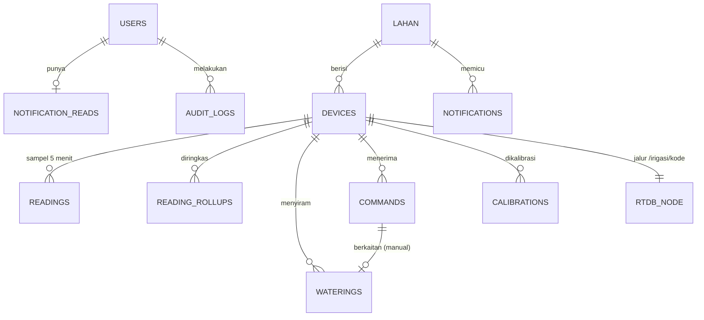

# Schema — GREENFLOW (Realtime Database + Cloud Firestore + Firebase Auth)

> **Versi:** 0.2 (disesuaikan dengan PRD v0.3, architecture v0.2, dan kode IoT v4) · **Tanggal:** 3 November 2026
> **Riwayat:** v0.1 (telemetri ke Express, satu sensor tanah, token perangkat) → **v0.2 (kotak surat RTDB per perangkat, 3 sensor tanah, konfigurasi per perangkat, tanpa `deviceStatus`/`deviceSecrets`)**
> **Dokumen berikutnya:** `rules.md` → `design.md`
> **Cakupan:** struktur data di RTDB dan Firestore, enum, validasi, indeks, retensi, pola akses, aturan hapus. Skema zod final di `packages/shared/src/schema/` **harus mengikuti dokumen ini**.

---

## 1. Ketentuan Umum

| Hal | Ketentuan |
|---|---|
| Dua penyimpanan | **RTDB** = kotak surat perangkat (status langsung, perintah, riwayat mentah, konfigurasi). **Firestore** = sumber kebenaran aplikasi. Arah data: perangkat → RTDB → Express → Firestore; konfigurasi/perintah: Firestore → Express → RTDB → perangkat |
| Akses | Hanya Admin SDK di Express yang membaca/menulis keduanya dari sisi aplikasi; ESP32 memakai REST ke RTDB (kredensial perangkat). Aturan keamanan kedua basis data menolak akses klien (bagian 13) |
| Identitas | Firebase Auth; `uid` = ID dokumen `users/{uid}` |
| Waktu | Firestore: `Timestamp` (UTC). RTDB: `ts` = milidetik epoch dari server Firebase (`{".sv":"timestamp"}`). **Waktu baku = `ts`**; string `waktu` RTC hanya informasi (AD-14). Tampilan WITA di frontend |
| Penamaan | Koleksi/field **camelCase Inggris** di Firestore; nilai enum **Bahasa Indonesia huruf kecil**. RTDB **mengikuti firmware apa adanya** (`snake_case`, huruf kapital pada `kategori`) |
| ID dokumen | Auto-ID Firestore kecuali dinyatakan lain |
| Nilai kosong | Firestore: field opsional ditulis `null`. RTDB: field boleh hilang; parser Express menganggapnya `null` |
| Denormalisasi | Nama (lahan, perangkat, pengguna) disalin ke dokumen riwayat sebagai *snapshot* |
| Persen | 0–100 (`number`), bukan 0–1 |
| Perangkat | **Satu perangkat = satu ESP32** dengan 3 sensor tanah (`s1`, `s2`, `s3`), DHT11, dan 1 pompa. Sensor dan pompa **bukan** entitas terpisah (AD-13) |

**Perubahan terhadap v0.1:** dihapus `deviceStatus` (status langsung ada di RTDB + cache), `deviceSecrets` (tidak ada token perangkat), dan parameter pada `lahan` (pindah ke `devices.config`, AD-19); `devices` kini hanya satu tipe; `readings`, `waterings`, `commands`, `calibrations` disesuaikan dengan data firmware.

---

## 2. Peta Data



### 2.1 Firestore
| Koleksi | ID dokumen | Ditulis oleh | Laju tulis | Retensi |
|---|---|---|---|---|
| `users` | uid Auth | auth, users | jarang | permanen (anonimkan saat dihapus) |
| `lahan` | auto | lahan | jarang | permanen |
| `devices` | **kode perangkat** | devices, parameters, calibration, bridge | jarang (+ saat transisi alarm / riwayat baru) | permanen |
| `readings` | `{kode}_{epochDetikSlot}` | sampler | 1 / 5 menit / perangkat | **TTL 90 hari** |
| `readingRollups` | `{kode}_{yyyyMMddHH}` | jobs | 1 / jam / perangkat | 2 tahun (usulan) |
| `waterings` | `{kode}_{kunciPushRTDB}` | bridge (dari `/riwayat`) | per siram | permanen |
| `commands` | auto | control, bridge | per perintah | **TTL 30 hari** |
| `notifications` | auto | bridge, jobs | per kejadian | **TTL 90 hari** |
| `notificationReads` | uid | notifications | saat dibaca | mengikuti `users` |
| `calibrations` | auto | calibration | jarang | permanen |
| `auditLogs` | auto | semua service | per aksi penting | **TTL 365 hari** (usulan) |

### 2.2 Realtime Database
```text
/irigasi/{kode}/
  status      ← ESP32 menimpa tiap 5 detik
  kontrol     ← Express menulis; ESP32 membaca tiap 2 detik
  riwayat/{kunciPush}   ← ESP32 menambah satu entri per siram selesai
  config      ← Express menulis; ESP32 membaca (setelah F1)
```
Selama firmware belum memakai jalur per perangkat (F3), perangkat tunggal memakai **`/irigasi`** langsung; `devices.rtdbPath` menyimpan jalur sebenarnya (bawaan `/irigasi/{kode}`).

---

## 3. Enum

| Nama | Nilai (Firestore) |
|---|---|
| `Role` | `admin`, `pengguna` |
| `UserStatus` | `aktif`, `nonaktif` |
| `ActiveStatus` (lahan, perangkat) | `aktif`, `nonaktif` |
| `Mode` | `otomatis`, `manual` (RTDB: `auto`, `manual`) |
| `Kategori` | `kering`, `normal`, `basah`, `lepas` (RTDB: `KERING`, `NORMAL`, `BASAH`, `LEPAS`) |
| `Trigger` (riwayat) | `otomatis`, `manual` |
| `CommandKind` | `siram`, `off`, `reset`, `mode` |
| `CommandStatus` | `menunggu`, `dijalankan`, `tidak_merespons`, `dibatalkan` |
| `ConfigSync` | `menunggu`, `sinkron`, `gagal` |
| `NotificationType` | `tanah_kering`, `sensor_bermasalah`, `perangkat_offline` |
| `Severity` | `peringatan`, `kritis` |

Pemetaan tingkat: `tanah_kering` = `peringatan`; `sensor_bermasalah` = `peringatan`; `perangkat_offline` = `kritis`.
Label & warna UI: `kering` = “Kering” merah; `normal` = “Normal” hijau; `basah` = “Basah” biru; `lepas` = “Sensor lepas” abu-abu. Label **selalu** ditampilkan sebagai teks.
Nilai alasan siram dari firmware (`reason`): `durasi selesai`, `perintah off`, `beralih ke auto`; nilai lain disimpan apa adanya.

---

## 4. Skema Realtime Database (kontrak dengan firmware)

Express **tidak mempercayai** data RTDB: setiap payload diparse dengan skema toleran (bidang tak dikenal diabaikan, bidang hilang → `null`, payload tak valid dicatat lalu dilewati).

### 4.1 `/irigasi/{kode}/status` (ditulis ESP32, ditimpa utuh)
| Bidang | Tipe | Keterangan |
|---|---|---|
| `tanah.s1`, `tanah.s2`, `tanah.s3` | `{raw: int 0–4095, pct: int 0–100}` | per sensor (persen dibulatkan oleh firmware) |
| `tanah.rata` | number (1 desimal) | rata-rata sensor valid; **nilai keputusan** |
| `tanah.kategori` | `"KERING"`\|`"NORMAL"`\|`"BASAH"`\|`"LEPAS"` | ambang bawaan 30/78 |
| `udara.suhu` | number (°C) | **tidak valid bila `dht_ok = false`** (firmware menahan nilai lama/29,0) |
| `udara.rh` | int (%) | |
| `udara.dht_ok` | boolean | |
| `fuzzy_detik` | number (2 desimal) | keluaran fuzzy saat ini (belum dibatasi 10 s) |
| `mode` | `"auto"`\|`"manual"` | **kebenaran mode** |
| `pompa` | boolean | |
| `cooldown_detik` | int ≥ 0 | |
| `siram_terakhir` | string `YYYY-MM-DD HH:MM:SS` atau `"-"` | jam RTC lokal tanpa zona waktu |
| `waktu` | string atau `"RTC-ERR"` | jam RTC lokal |
| `wifi_rssi` | int (dBm) | |
| `uptime_s` | int | |
| `ts` | int (ms epoch, server) | **waktu baku** |
| `ack_id` | int | id perintah `/kontrol` terakhir yang dijalankan — **tambahan F2** |
| `cfg_ver` | int | versi `/config` yang sedang diterapkan — **tambahan F2** |

### 4.2 `/irigasi/{kode}/kontrol` (ditulis Express)
| Bidang | Tipe | Keterangan |
|---|---|---|
| `mode` | `"auto"`\|`"manual"` | mode yang diinginkan; diterapkan ESP32 saat berubah |
| `aksi` | `"siram"`\|`"off"`\|`"reset"`\|`""` | **`"on"` tidak dipakai Express** (firmware memindahkan dirinya ke manual); `siram` sudah mencakup |
| `detik` | number | durasi siram (1…`maxManual`) |
| `id` | int | naik 1 tiap perintah beraksi; aksi dijalankan **sekali** saat `id` berubah |

Penulisan **selalu melalui transaksi**; `id` tidak diubah untuk perubahan mode saja (aksi kosong).

### 4.3 `/irigasi/{kode}/riwayat/{kunciPush}` (ditulis ESP32)
| Bidang | Tipe | Keterangan |
|---|---|---|
| `waktu` | string | jam RTC saat pompa berhenti |
| `durasi_detik` | number (1 desimal) | durasi nyata |
| `mode` | `"manual"`\|`"otomatis"` | |
| `tanah_awal` | int (%) | rata-rata saat pompa mulai |
| `suhu` | number (°C) | |
| `alasan` | string | lihat bagian 3 |
| `ts` | int (ms epoch, server) | saat entri diterima server Firebase (bisa lebih lambat dari akhir siram bila antrean tertunda) |

Tidak ada: pelaku, `tanah_akhir`, id perintah. Entri yang sudah tersalin dan > 30 hari dipangkas job `rtdb-trim`.

### 4.4 `/irigasi/{kode}/config` (ditulis Express; **dibaca firmware setelah F1**)
| Bidang | Tipe | Bawaan |
|---|---|---|
| `version` | int ≥ 1 | naik tiap simpan |
| `ambang.kering`, `ambang.basah` | number | 30, 78 |
| `durasi.maxOtomatis`, `durasi.maxManual`, `durasi.min` | number (detik) | 10, 15, 1 |
| `cooldown` | int (detik) | 300 |
| `kalibrasi.s1/s2/s3` | `{kering: int, basah: int}` | S1 {2718, 1074}, S2 {2528, 1096}, S3 {2627, 1070} — **nilai kering masih “SEMENTARA” di kode** |
| `fuzzy.tanah.{kering,normal,basah}` | `[a,b,c,d]` | [-1000,-1000,20,40], [20,40,68,88], [68,88,1000,1000] |
| `fuzzy.suhu.{sejuk,normal,panas}` | `[a,b,c,d]` | [-1000,-1000,25,29], [25,29,31,35], [31,35,1000,1000] |
| `fuzzy.z` | 3×3 number | [[3,6,10],[0,3,6],[0,0,0]] (baris tanah, kolom suhu) |

`±1000` = “tak terbatas” (konvensi firmware). Bentuk `config` bersarang memerlukan parser JSON yang lebih lengkap di firmware (mis. ArduinoJson); bila tim IoT memilih bentuk **datar** agar cocok dengan pengurai sederhana yang ada, hanya lapisan `bridge` yang berubah (Q26).

---

## 5. Koleksi Firestore

Kolom **W** = wajib. Tipe `ts` = `Timestamp`.

### 5.1 `users/{uid}`
| Field | Tipe | W | Aturan |
|---|---|:-:|---|
| `name` | string | ✔ | 2–80, di-*trim* |
| `email` | string | ✔ | huruf kecil, cermin Auth |
| `role` | Role | ✔ | register publik → `pengguna`; **tidak dari body request** |
| `status` | UserStatus | ✔ | `aktif` saat register (Q1) |
| `createdBy` | string | ✔ | `"self"` atau uid admin |
| `createdAt`, `updatedAt` | ts | ✔ | |
| `lastLoginAt` | ts \| null | ✔ | diperbarui maks. 1×/10 menit |

Dilayani dari **cache**. Custom claim `role` dijaga sinkron (AD-04).

### 5.2 `lahan/{lahanId}`
| Field | Tipe | W | Aturan |
|---|---|:-:|---|
| `name` | string | ✔ | 3–80, unik (tanpa membedakan huruf besar/kecil) |
| `address` | string | ✔ | 3–200 |
| `latitude`, `longitude` | number \| null | | −90…90 / −180…180; keduanya terisi atau keduanya `null` |
| `areaM2` | number \| null | | > 0 |
| `note` | string \| null | | ≤ 300 |
| `status` | ActiveStatus | ✔ | |
| `createdAt`, `updatedAt`, `createdBy` | | ✔ | |

Lahan **tidak** menyimpan parameter (AD-19).

### 5.3 `devices/{kode}` — ID dokumen = **kode perangkat**
Kode: `^[A-Z0-9-]{3,20}$` (mis. `ESP-001`), **tidak dapat diubah**, unik karena menjadi ID dokumen.

| Field | Tipe | W | Aturan |
|---|---|:-:|---|
| `name` | string | ✔ | 3–80 |
| `lahanId` | string | ✔ | merujuk `lahan` yang ada |
| `status` | ActiveStatus | ✔ | `nonaktif` ⇒ jembatan berhenti mendengarkan dan kontrol ditolak |
| `note` | string \| null | | ≤ 300 |
| `rtdbPath` | string | ✔ | `^/[A-Za-z0-9/_-]{1,60}$`; bawaan `/irigasi/{kode}`; perangkat lama: `/irigasi`; **unik antar perangkat** |
| `config` | map | ✔ | lihat 5.3.1 |
| `configSync` | ConfigSync | ✔ | status penulisan `/config` ke RTDB |
| `appliedConfigVersion` | int \| null | ✔ | cermin `status.cfg_ver` (ditulis hanya saat berubah) |
| `lastRiwayatKey` | string \| null | ✔ | kunci `/riwayat` terakhir yang tersalin (titik mulai listener) |
| `alerts` | map | ✔ | `{ tanahKering, sensorBermasalah, perangkatOffline }`, tiap nilai `null` atau `{ since: ts, notificationId: string }` |
| `fw` | string \| null | | versi firmware bila dikirim (F6) |
| `createdAt`, `updatedAt`, `createdBy` | | ✔ | |

#### 5.3.1 `config` (di dalam `devices`)
| Field | Tipe | Bawaan | Rentang |
|---|---|---:|---|
| `version` | int | 1 | ≥ 1, +1 tiap simpan |
| `ambang.kering` | number | 30 | 0–100 |
| `ambang.basah` | number | 78 | 0–100 |
| `durasi.maxOtomatis` | int | 10 | 1–60 |
| `durasi.maxManual` | int | 15 | 1–60 |
| `durasi.min` | number | 1 | 0,5–10 dan ≤ `maxOtomatis` |
| `cooldown` | int | 300 | 0–3600 |
| `kalibrasi.{s1,s2,s3}.kering` | int | 2718 / 2528 / 2627 | 0–4095 |
| `kalibrasi.{s1,s2,s3}.basah` | int | 1074 / 1096 / 1070 | 0–4095 |
| `fuzzy.tanah.*`, `fuzzy.suhu.*` | `[a,b,c,d]` | spesifikasi firmware (PRD 7.2) | −1000…1000 |
| `fuzzy.z` | 3×3 number | [[3,6,10],[0,3,6],[0,0,0]] | 0–60 |
| `updatedAt`, `updatedBy` | ts, uid | — | |

**Aturan validasi (gagal → E-07):**
1. `0 ≤ ambang.kering < ambang.basah ≤ 100`
2. `durasi.min ≤ durasi.maxOtomatis`
3. Setiap sensor: `kering − basah ≥ 200` (sensor kapasitif: ADC **turun** saat basah, konsisten dengan `SOIL_DRY > SOIL_WET` pada kode)
4. Setiap trapesium: `a ≤ b ≤ c ≤ d`
5. `fuzzy.z`: tiap kolom suhu non-menaik menuju tanah lebih basah (`z[kering][j] ≥ z[normal][j] ≥ z[basah][j]`) — tanah lebih kering tidak boleh disiram lebih singkat

Nilai bawaan ada di `packages/shared` sebagai `DEFAULT_DEVICE_CONFIG` (bersumber dari kode IoT v4, PRD bagian 7), **bukan** di modul fuzzy.

### 5.4 `readings/{kode}_{epochDetikSlot}` — sampel berkala
ID memakai awal *slot waktu* 5 menit dalam detik epoch (`floor(ts/slot)*slot`), sehingga restart/ulang proses tidak menggandakan data (AD-11).

| Field | Tipe | Keterangan |
|---|---|---|
| `deviceId`, `lahanId` | string | |
| `sampledAt` | ts | `status.ts` saat pengambilan sampel |
| `soil` | map | `{ avg, s1, s2, s3 }` (persen) |
| `raw` | map | `{ s1, s2, s3 }` (nilai mentah; berguna untuk kalibrasi) |
| `kategori` | Kategori | |
| `air` | map | `{ tempC, humidityPct, dhtOk }`; `tempC`/`humidityPct` = `null` bila `dhtOk = false` |
| `fuzzySec` | number | `fuzzy_detik` saat itu |
| `mode` | Mode | |
| `pumpOn` | boolean | |
| `cooldownSec` | int | |
| `rssi`, `uptimeSec` | int | |
| `expireAt` | ts | `sampledAt + 90 hari` → **TTL** |

### 5.5 `readingRollups/{kode}_{yyyyMMddHH}` — ringkasan per jam (UTC)
| Field | Tipe |
|---|---|
| `deviceId`, `lahanId` | string |
| `hourStart` | ts |
| `count` | integer |
| `soilAvg`, `soilMin`, `soilMax` | number |
| `tempAvg` | number \| null |
| `wateringCount`, `wateringSec` | integer, number |
| `createdAt` | ts |

Dibuat job `hourly-rollup` (idempoten: ID tetap, `set` menimpa). Sumber grafik 7 hari dan laporan.

### 5.6 `waterings/{kode}_{kunciPushRTDB}` — riwayat penyiraman (FR-30)
| Field | Tipe | W | Keterangan |
|---|---|:-:|---|
| `deviceId`, `deviceName` | string | ✔ | + snapshot |
| `lahanId`, `lahanName` | string | ✔ | + snapshot |
| `rtdbKey` | string | ✔ | kunci entri RTDB (sumber) |
| `trigger` | Trigger | ✔ | dari `mode` firmware |
| `triggeredBy`, `triggeredByName` | string \| null | | pelaku (hanya `manual`; **sebaik mungkin**, dari pencocokan perintah dalam jendela 2 menit); nama diganti `"(akun dihapus)"` saat akun dihapus |
| `commandId` | string \| null | | perintah yang cocok |
| `endedAt` | ts | ✔ | dari `ts` entri RTDB |
| `startedAt` | ts | ✔ | turunan: `endedAt − durationSec` (aproksimasi) |
| `durationSec` | number | ✔ | `durasi_detik` |
| `soilBeforePct` | int | ✔ | `tanah_awal` |
| `tempC` | number \| null | | `suhu` |
| `reason` | string | ✔ | `alasan` apa adanya |
| `endedAtRtc` | string \| null | | `waktu` RTC, hanya referensi |
| `createdAt` | ts | ✔ | |

Tidak tersedia dari firmware: kelembapan sesudah siram, id perintah, status gagal. UI tidak menampilkannya.

### 5.7 `commands/{id}` — perintah dari web
| Field | Tipe | Keterangan |
|---|---|---|
| `deviceId`, `lahanId` | string | |
| `kind` | CommandKind | `siram`, `off`, `reset`, `mode` |
| `params` | map | `{ durationSec? , mode? }` |
| `kontrolId` | int \| null | `id` yang ditulis ke `/kontrol` (`null` untuk perubahan mode saja) |
| `status` | CommandStatus | `menunggu → dijalankan` atau `tidak_merespons` (15 detik) atau `dibatalkan` |
| `ackMethod` | `"ack_id"` \| `"heuristik"` \| null | cara pengakuan (heuristik sebelum F2) |
| `requestedBy`, `requestedByName` | string | uid + snapshot |
| `createdAt`, `ackedAt` | ts, ts \| null | |
| `purgeAt` | ts | `createdAt + 30 hari` → **TTL** |

Hanya **satu** perintah `menunggu` per perangkat; perintah baru membatalkan yang lama. Saat restart, perintah `menunggu` dipulihkan dengan satu kueri.

### 5.8 `notifications/{id}`
| Field | Tipe | Keterangan |
|---|---|---|
| `type` | NotificationType | |
| `severity` | Severity | bagian 3 |
| `lahanId`, `lahanName` | string | |
| `deviceId`, `deviceName` | string | |
| `title`, `message` | string | Indonesia, siap tampil (mis. “Tanah kering di Lahan Sawi A (24 %)”) |
| `data` | map | konteks, mis. `{ soilAvg: 24 }` |
| `createdAt` | ts | |
| `resolvedAt` | ts \| null | diisi saat pulih (FR-41) |
| `purgeAt` | ts | `createdAt + 90 hari` → **TTL** |

Global (semua pengguna login). Status baca per pengguna di 5.9.

### 5.9 `notificationReads/{uid}`
| Field | Tipe | Keterangan |
|---|---|---|
| `readAllBefore` | ts | notifikasi dengan `createdAt ≤` nilai ini dianggap dibaca |
| `readIds` | string[] | ID dibaca satu per satu **setelah** `readAllBefore`; maks. 200 |
| `updatedAt` | ts | |

Belum dibaca = `createdAt > readAllBefore` **dan** `id ∉ readIds`. “Tandai semua dibaca” ⇒ `readAllBefore = now`, `readIds = []`.

### 5.10 `calibrations/{id}` — riwayat kalibrasi (FR-56)
| Field | Tipe | Aturan |
|---|---|---|
| `deviceId`, `lahanId` | string | |
| `sensor` | `"s1"`\|`"s2"`\|`"s3"` | |
| `kering`, `basah` | integer | 0–4095; `kering − basah ≥ 200` |
| `source` | `"manual"` \| `"live"` | `live` = diambil dari tombol “Gunakan nilai sekarang” |
| `note` | string \| null | ≤ 300 |
| `createdAt`, `createdBy`, `createdByName` | | |

Menyimpan kalibrasi memperbarui `devices.config.kalibrasi.{sensor}` dan `config.version + 1` **dalam satu transaksi**, lalu disalin ke RTDB `/config`.
Konversi di ESP32: `pct = clamp( (kering − raw) ÷ (kering − basah) × 100 , 0 , 100 )`.

### 5.11 `auditLogs/{id}`
| Field | Tipe | Keterangan |
|---|---|---|
| `actorId`, `actorName`, `actorRole` | string | `actorName` = snapshot; `"(akun dihapus)"` setelah penghapusan |
| `action` | string | daftar di bawah |
| `targetType` | string | `user`, `lahan`, `device`, `config`, `calibration`, `command` |
| `targetId` | string | |
| `summary` | string | kalimat Indonesia singkat |
| `changes` | map \| null | `{ before, after }` field **non-sensitif** saja |
| `requestId` | string | tautan ke log aplikasi (**tanpa menyimpan IP** — UU PDP) |
| `createdAt`, `purgeAt` | ts | `purgeAt = createdAt + 365 hari` → **TTL** |

`action`: `user.create`, `user.update`, `user.role_change`, `user.disable`, `user.enable`, `user.delete`, `user.reset_password`, `lahan.create`, `lahan.update`, `lahan.delete`, `device.create`, `device.update`, `device.delete`, `config.parameters_update`, `config.fuzzy_update`, `config.fuzzy_reset`, `calibration.create`, `control.mode_change`, `control.pump_siram`, `control.pump_off`, `control.reset_cooldown`. Kegagalan login **tidak** ditulis ke Firestore (cukup log aplikasi).

---

## 6. Contoh Data

```json
// RTDB /irigasi/ESP-001/status
{
  "tanah": { "s1": {"raw": 1817, "pct": 55}, "s2": {"raw": 1672, "pct": 56}, "s3": {"raw": 1778, "pct": 55}, "rata": 55.3, "kategori": "NORMAL" },
  "udara": { "suhu": 29.5, "rh": 68, "dht_ok": true },
  "fuzzy_detik": 3.0, "mode": "auto", "pompa": false, "cooldown_detik": 120,
  "siram_terakhir": "2026-11-03 07:20:11", "waktu": "2026-11-03 07:25:02",
  "wifi_rssi": -61, "uptime_s": 86400, "ts": 1793600702000, "ack_id": 12, "cfg_ver": 3
}
```

```json
// RTDB /irigasi/ESP-001/kontrol
{ "mode": "auto", "aksi": "siram", "detik": 5, "id": 13 }
```

```json
// RTDB /irigasi/ESP-001/riwayat/-Nabc123
{ "waktu": "2026-11-03 07:20:11", "durasi_detik": 8.0, "mode": "otomatis", "tanah_awal": 20, "suhu": 33.0, "alasan": "durasi selesai", "ts": 1793600411000 }
```

```json
// Firestore devices/ESP-001
{
  "name": "Pengendali Lahan Sawi A", "lahanId": "lhn_abc", "status": "aktif", "note": null,
  "rtdbPath": "/irigasi/ESP-001",
  "config": {
    "version": 3,
    "ambang": { "kering": 30, "basah": 78 },
    "durasi": { "maxOtomatis": 10, "maxManual": 15, "min": 1 },
    "cooldown": 300,
    "kalibrasi": { "s1": {"kering": 2718, "basah": 1074}, "s2": {"kering": 2528, "basah": 1096}, "s3": {"kering": 2627, "basah": 1070} },
    "fuzzy": {
      "tanah": { "kering": [-1000,-1000,20,40], "normal": [20,40,68,88], "basah": [68,88,1000,1000] },
      "suhu":  { "sejuk": [-1000,-1000,25,29], "normal": [25,29,31,35], "panas": [31,35,1000,1000] },
      "z": [[3,6,10],[0,3,6],[0,0,0]]
    },
    "updatedAt": "2026-11-03T00:10:00Z", "updatedBy": "uidAdmin1"
  },
  "configSync": "sinkron", "appliedConfigVersion": 3, "lastRiwayatKey": "-Nabc123",
  "alerts": { "tanahKering": null, "sensorBermasalah": null, "perangkatOffline": null },
  "fw": null,
  "createdAt": "2026-11-01T06:05:00Z", "updatedAt": "2026-11-03T00:10:00Z", "createdBy": "uidAdmin1"
}
```

```json
// Firestore readings/ESP-001_1793600700
{
  "deviceId": "ESP-001", "lahanId": "lhn_abc", "sampledAt": "2026-11-03T07:25:00Z",
  "soil": { "avg": 55.3, "s1": 55, "s2": 56, "s3": 55 }, "raw": { "s1": 1817, "s2": 1672, "s3": 1778 },
  "kategori": "normal",
  "air": { "tempC": 29.5, "humidityPct": 68, "dhtOk": true },
  "fuzzySec": 3.0, "mode": "otomatis", "pumpOn": false, "cooldownSec": 120, "rssi": -61, "uptimeSec": 86400,
  "expireAt": "2027-02-01T07:25:00Z"
}
```

```json
// Firestore waterings/ESP-001_-Nabc123
{
  "deviceId": "ESP-001", "deviceName": "Pengendali Lahan Sawi A", "lahanId": "lhn_abc", "lahanName": "Lahan Sawi A",
  "rtdbKey": "-Nabc123", "trigger": "otomatis", "triggeredBy": null, "triggeredByName": null, "commandId": null,
  "endedAt": "2026-11-03T07:20:11Z", "startedAt": "2026-11-03T07:20:03Z", "durationSec": 8.0,
  "soilBeforePct": 20, "tempC": 33.0, "reason": "durasi selesai", "endedAtRtc": "2026-11-03 07:20:11",
  "createdAt": "2026-11-03T07:20:12Z"
}
```

---

## 7. Indeks

Koleksi kecil yang dilayani dari **cache** (`users`, `lahan`, `devices`) tidak membutuhkan indeks komposit; daftar, pencarian, dan urutan dikerjakan di memori.

Indeks komposit (`firebase/firestore.indexes.json`):

| Koleksi | Field | Dipakai oleh |
|---|---|---|
| `readings` | `deviceId ↑`, `sampledAt ↓` | seri “hari ini”, job rollup, ekspor per perangkat |
| `readings` | `lahanId ↑`, `sampledAt ↓` | ekspor per lahan |
| `readingRollups` | `deviceId ↑`, `hourStart ↑` | grafik 7 hari, laporan |
| `readingRollups` | `lahanId ↑`, `hourStart ↑` | laporan per lahan |
| `waterings` | `lahanId ↑`, `endedAt ↓` | riwayat + filter lahan & tanggal |
| `waterings` | `deviceId ↑`, `endedAt ↓` | riwayat per perangkat |
| `commands` | `deviceId ↑`, `createdAt ↓` | status perintah, pembatalan perintah lama |
| `calibrations` | `deviceId ↑`, `createdAt ↓` | riwayat kalibrasi |
| `auditLogs` | `actorId ↑`, `createdAt ↓` | audit per pelaku |

Indeks **satu field** otomatis cukup untuk `waterings.endedAt` (semua lahan), `notifications.createdAt`, `auditLogs.createdAt`, dan `waterings.triggeredBy` (anonimisasi).

---

## 8. Retensi dan TTL

| Data | Mekanisme | Masa |
|---|---|---|
| `readings` | TTL field `expireAt` | 90 hari (NFR-10) |
| `commands` | TTL field `purgeAt` | 30 hari |
| `notifications` | TTL field `purgeAt` | 90 hari |
| `auditLogs` | TTL field `purgeAt` | 365 hari |
| RTDB `/riwayat` | job `rtdb-trim` (hanya entri yang sudah tersalin) | 30 hari |

- TTL diaktifkan lewat **Console atau `gcloud firestore fields ttls update … --enable-ttl`** (satu field TTL per kelompok koleksi). Di **Emulator TTL tidak berjalan**; tes tidak boleh mengandalkannya.
- Dokumen kedaluwarsa dihapus biasanya dalam ≤ 24 jam dan **masih dapat muncul di kueri** selama itu; karena itu kueri `readings` selalu dibatasi rentang `sampledAt` yang jauh lebih pendek dari 90 hari, dan kueri `notifications` memakai `limit`.
- `readingRollups`, `waterings`, `calibrations` tidak ber-TTL (kecil; riwayat siram adalah bahan evaluasi dinas).
- Skema ini tidak memakai subkoleksi (TTL tidak menghapus subkoleksi).

---

## 9. Pola Akses dan Biaya

| Kebutuhan (API) | Sumber | Baca Firestore |
|---|---|---|
| Status perangkat / ringkasan dashboard (polling 10 dtk) | Cache (diisi listener RTDB) | **0** |
| Grafik hari ini (288 titik) | Cache seri; dibangun dari `readings` saat start/miss | 0 (≈ 288 sekali per perangkat saat start) |
| Grafik 7 hari | `readingRollups` 7 hari | ≤ 168 per perangkat, cache 5 menit |
| Riwayat (10 baris/halaman) | `waterings` kursor `endedAt` | 10 / halaman |
| Laporan ringkas | `readingRollups` + `waterings` dalam rentang | ≈ 24 × hari + jumlah siram; cache 5 menit |
| Ekspor | `waterings` / `readings` | per dokumen; `readings` ≤ 31 hari |
| Notifikasi, badge | Cache 100 notifikasi terbaru + `notificationReads/{uid}` | 0–1 |
| Otorisasi tiap request | Cache `users` | 0 |
| Pratinjau fuzzy | Modul fuzzy + `devices.config` (cache) | 0 |
| Nilai mentah langsung (kalibrasi) | Cache status | 0 |
| Sampel tiap 5 menit | cache → tulis | **1 tulis / perangkat** |
| Riwayat siram baru | RTDB listener → tulis | 1 tulis `waterings` + 1 `devices.lastRiwayatKey` |
| Transisi alarm | tulis | 1 `notifications` + 1 `devices.alerts` |
| Kelola akun/lahan/perangkat/config | cache + tulis | 0 baca, 1–2 tulis (+ audit) |
| Cek E-08 (hapus) | kueri `limit 1` pada `devices`/`waterings` | ≤ 2 |

*Listener* snapshot Firestore (users, lahan, devices): biaya = jumlah dokumen saat start + 1 baca per perubahan.
RTDB: ESP32 menulis `/status` ± 0,9 KB tiap 5 detik; Express menerima perubahan lewat listener. Pantau bandwidth di Console.

---

## 10. Aturan Integritas dan Penghapusan (E-08)

Firestore tidak menjamin integritas referensial; service wajib menegakkannya.

| Entitas | Boleh dihapus bila | Perlakuan |
|---|---|---|
| `lahan` | tidak ada `devices` dengan `lahanId` tsb **dan** tidak ada `waterings` untuk lahan itu | selain itu tolak **409 / E-08**, sarankan `nonaktif` |
| `devices` | tidak ada `waterings` untuk perangkat itu | hapus `devices` + `calibrations` miliknya dalam satu *batch*; lepas listener; hapus node RTDB `/irigasi/{kode}` hanya bila `rtdbPath` ≠ `/irigasi` (jalur lama tidak dihapus otomatis); sisa `readings` hilang lewat TTL |
| `users` | bukan admin terakhir, bukan akun penghapus sendiri | hapus Auth + `users` + `notificationReads`; **anonimkan** `waterings.triggeredByName`, `commands.requestedByName`, `auditLogs.actorName` menjadi `"(akun dihapus)"` |

Perubahan yang harus **menyebar** (satu transaksi/batch):
- Mengubah `lahan.name` ⇒ hanya dokumen baru yang memakai nama baru (snapshot lama tidak diubah).
- Memindahkan perangkat ke lahan lain (`lahanId`) ⇒ data lama tetap menyimpan `lahanId` lamanya.
- Mengubah `rtdbPath` ⇒ listener dipasang ulang; `lastRiwayatKey` dikosongkan.
- Menyimpan konfigurasi/kalibrasi ⇒ `config.version + 1`, `configSync = "menunggu"`, lalu tulis RTDB.
- Menonaktifkan perangkat ⇒ perintah `menunggu` dibatalkan; listener dilepas.

Konkurensi: `devices/{kode}` dibuat dengan `create()` (kode unik); nama lahan unik dan “admin terakhir” dicek dalam transaksi; penulisan `/kontrol` memakai transaksi RTDB.

---

## 11. Validasi dan Kontrak Kode

- Satu sumber kebenaran: skema zod di `packages/shared/src/schema/*.ts`, dipakai **backend** dan **frontend**.
- Aturan 5.3.1 diimplementasikan sebagai `superRefine` pada `deviceConfigSchema` dengan kode galat `E-07`.
- Konversi `Timestamp ↔ ISO-8601` hanya di lapisan *repository*; API selalu bertukar string ISO UTC.
- Konversi RTDB ↔ domain (mis. `auto` ↔ `otomatis`, `KERING` ↔ `kering`) hanya di `modules/bridge`.
- Repository mengembalikan tipe domain (bukan snapshot SDK).

```ts
const bound = z.number().min(-1000).max(1000);
const trapezoid = z.tuple([bound, bound, bound, bound]).refine(
  ([a, b, c, d]) => a <= b && b <= c && c <= d,
  "titik trapesium harus a ≤ b ≤ c ≤ d",
);
const sensorCal = z.object({ kering: z.number().int().min(0).max(4095), basah: z.number().int().min(0).max(4095) });
const row = z.array(z.number().min(0).max(60)).length(3);

export const deviceConfigSchema = z.object({
  ambang: z.object({ kering: z.number().min(0).max(100), basah: z.number().min(0).max(100) }),
  durasi: z.object({
    maxOtomatis: z.number().int().min(1).max(60),
    maxManual: z.number().int().min(1).max(60),
    min: z.number().min(0.5).max(10),
  }),
  cooldown: z.number().int().min(0).max(3600),
  kalibrasi: z.object({ s1: sensorCal, s2: sensorCal, s3: sensorCal }),
  fuzzy: z.object({
    tanah: z.object({ kering: trapezoid, normal: trapezoid, basah: trapezoid }),
    suhu: z.object({ sejuk: trapezoid, normal: trapezoid, panas: trapezoid }),
    z: z.tuple([row, row, row]),
  }),
}).superRefine((c, ctx) => {
  const bad = (msg: string) => ctx.addIssue({ code: "custom", message: msg, params: { code: "E-07" } });
  if (!(c.ambang.kering < c.ambang.basah)) bad("ambang.kering harus lebih kecil dari ambang.basah");
  if (c.durasi.min > c.durasi.maxOtomatis) bad("durasi.min tidak boleh melebihi durasi.maxOtomatis");
  for (const [s, k] of Object.entries(c.kalibrasi)) {
    if (k.kering - k.basah < 200) bad(`kalibrasi ${s}: selisih kering dan basah minimal 200`);
  }
  for (let j = 0; j < 3; j++) {
    if (!(c.fuzzy.z[0][j] >= c.fuzzy.z[1][j] && c.fuzzy.z[1][j] >= c.fuzzy.z[2][j])) {
      bad("fuzzy.z: tanah lebih kering tidak boleh disiram lebih singkat (kering ≥ normal ≥ basah pada tiap kolom suhu)");
    }
  }
});
```

---

## 12. Seed dan Data Awal

| Item | Cara |
|---|---|
| Admin pertama | `npm run seed:admin -w backend`: akun Auth, claim `admin`, `users/{uid}` + `notificationReads/{uid}` |
| Nilai bawaan | `DEFAULT_DEVICE_CONFIG` dari `packages/shared` dipakai saat membuat perangkat (`config.version = 1`) |
| Data simulasi | `npm run seed:demo -w backend` (khusus **emulator**, menolak `NODE_ENV=production`): 1 lahan, 1 perangkat (`rtdbPath` `/irigasi/ESP-001`), 24 jam `readings` sintetis, beberapa `waterings` |
| Simulator | `npm run sim -w simulator` meniru firmware v4 pada emulator RTDB: menulis `/status` (5 dtk), membaca `/kontrol` (2 dtk), menulis `/riwayat`, membaca `/config` bila ada, memakai modul fuzzy dan cooldown yang sama |

---

## 13. Aturan Keamanan

`firebase/firestore.rules`:
```text
rules_version = '2';
service cloud.firestore {
  match /databases/{database}/documents {
    match /{document=**} { allow read, write: if false; }
  }
}
```
`firebase/database.rules.json`:
```json
{ "rules": { ".read": false, ".write": false } }
```
Admin SDK mengabaikan aturan ini, sehingga hanya Express yang dapat mengakses data dari sisi aplikasi. **Catatan:** ESP32 yang memakai *database secret* juga mengabaikan aturan RTDB — karena itu F4/F5 (pemisahan kredensial, kredensial sempit) penting, dan jalur naik kelasnya adalah custom token per perangkat dengan aturan per jalur (architecture bagian 13). Tes integrasi wajib membuktikan akses klien tanpa Admin SDK ke setiap koleksi dan jalur RTDB ditolak.

---

## 14. Perkiraan Volume

Untuk 1 perangkat, sampel 5 menit, retensi `readings` 90 hari:

| Data | Perkiraan |
|---|---|
| `readings` | 288/hari → ≈ 26.000 dokumen aktif (± 450 B → ≈ 12 MB) |
| `readingRollups` | 24/hari → ≈ 8.800/tahun |
| `waterings` | ≈ 5–50/hari tergantung kondisi tanah |
| RTDB `/status` | 1 node (± 0,9 KB, ditimpa) |
| RTDB `/riwayat` | dipangkas setelah 30 hari |

Dengan 10 perangkat ≈ 120 MB di Firestore — jauh di bawah batas penyimpanan gratis; pembatas utama adalah **kuota tulis harian** (architecture bagian 12) dan bandwidth RTDB.

---

## 15. Pertanyaan Terbuka untuk `schema.md`

| # | Pertanyaan | Status / usulan bawaan |
|---|---|---|
| Q14 | Arah ADC sensor kapasitif | ✅ Terjawab oleh kode IoT: ADC turun saat basah (`SOIL_DRY > SOIL_WET`) |
| Q15 | Satu lahan boleh punya lebih dari satu perangkat? | Ya (skema mengizinkan) |
| Q16 | Retensi `auditLogs` 365 hari, `readingRollups` 2 tahun cukup? | Ya |
| Q17 | Pengguna boleh menghapus akunnya sendiri (hak hapus data, UU PDP)? | Belum di v1; penghapusan lewat admin |
| Q26 | Bentuk `/config`: **bersarang** (usulan) atau **datar** agar cocok dengan pengurai JSON sederhana di firmware? | Bersarang; tim IoT memutuskan saat mengerjakan F1 |
| Q27 | Nilai kalibrasi *kering* S1–S3 masih “SEMENTARA” di kode — kapan nilai tetapnya? | Tim IoT mengisi lewat halaman Kalibrasi |

---

## 16. Jejak ke PRD dan Arsitektur

| Kebutuhan | Data / bagian |
|---|---|
| FR-01…07 Akun | `users`, Firebase Auth, 5.1 |
| FR-10…16 Dashboard | RTDB `status` (4.1), `readings`, `readingRollups` (5.4, 5.5), 9 |
| FR-20…24 Kontrol | RTDB `kontrol` (4.2), `commands` (5.7) |
| FR-30 Riwayat | RTDB `riwayat` (4.3), `waterings` (5.6), 7 |
| FR-31, 32 Laporan/ekspor | `readingRollups`, `waterings`, 9 |
| FR-40, 41 Notifikasi | `notifications`, `notificationReads`, `devices.alerts` (5.8, 5.9, 5.3) |
| FR-50…53 Lahan, perangkat, jalur, E-08 | `lahan`, `devices.rtdbPath`, 5.2, 5.3, 10 |
| FR-54, 55 Parameter & fuzzy | `devices.config` (5.3.1), RTDB `config` (4.4), 11 |
| FR-56 Kalibrasi | `calibrations` (5.10), `config.kalibrasi` |
| FR-61 Audit | `auditLogs` (5.11) |
| F1, F2 (firmware) | `config`, `ack_id`, `cfg_ver` (4.1, 4.4) |
| NFR-05, 06 Keamanan, privasi | 5.11, 10, 13 |
| NFR-10 Retensi | bagian 8 |
| D11, Q18 Fuzzy di ESP32 | `config.fuzzy` sebagai konfigurasi; modul server hanya pratinjau |
| D12, Q9 Hardware nyata | tidak ada koleksi/field untuk hujan/level/aliran |
| D14 Label 30/78 | 3, 5.3.1 |
| AD-10, AD-11, AD-13, AD-17, AD-19 | 5.3, 5.4, 5.6, 5.3.1 |